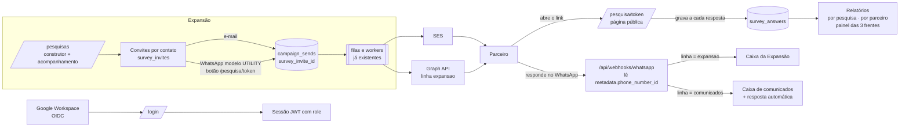

# Plano — Visão da Expansão: pesquisas com parceiros, caixa própria e segundo número

> Plano de implementação escrito em 22/10/2026 sobre o código atual (commit c30d3ff).
> Os e-mails das profissionais da Expansão NÃO ficam neste arquivo (repositório público):
> são cadastrados em produção, como os dos líderes do acompanhamento.

## 1. Resumo executivo

- **Um perfil novo, `expansao`, no mecanismo que já existe.** `lib/perfis.ts`
  ganha o terceiro perfil, seus prefixos de rota e sua página inicial
  (`/pesquisas`). O middleware e o menu já filtram por `rotaPermitida`; e
  `lib/escopo-parceiros.ts` já trata todo não-admin como "só parceiros", então
  a Expansão nasce sem ver leads nem a lista de leads, sem código novo ali.
- **Pesquisas são o bloco grande e inteiramente novo.** Quatro tabelas
  (`surveys`, `survey_questions`, `survey_invites`, `survey_answers`), um
  construtor de formulário simples (sem arrastar-e-soltar), uma página pública
  por convite (`/pesquisa/<token>`) com **gravação a cada resposta** — o
  parceiro fecha e volta quando quiser — e relatórios em SVG no mesmo estilo
  dos atuais. Cada convite é de UM contato: a resposta nasce ligada ao parceiro.
- **Convites e lembretes reaproveitam o pipeline de envio.** Vão por
  `campaign_sends` + filas + workers, como as automações fizeram: entrega,
  leitura, bounce e custo já funcionam pelos webhooks existentes. E-mail usa um
  layout transacional fixo (assunto + texto + botão); WhatsApp usa um modelo
  UTILITY aprovado com **botão de link dinâmico** (`…/pesquisa/{{1}}`), que o
  módulo de modelos ainda não suporta — é a única mudança no modelo de templates.
- **Segundo número = "linha".** Hoje tudo assume um número
  (`WHATSAPP_PHONE_NUMBER_ID`). Entra a noção de linha (`comunicados` |
  `expansao`) no cliente da Graph API, no webhook (que passa a ler
  `metadata.phone_number_id`), em `whatsapp_conversations` (uma conversa por
  **linha + telefone**) e na caixa de conversas (filtro por linha; a Expansão
  só vê a dela). A resposta automática "aqui não é atendimento" fica restrita à
  linha de comunicados. Modelos são da WABA, não do número: os aprovados servem
  às duas linhas.
- **Login com Google Workspace sem dependência nova.** OpenID Connect contra o
  Google com `fetch` + `jose` (já usado para a sessão). Só entra quem o
  administrador já cadastrou com perfil; o Google autentica, o sistema
  autoriza. `password_hash` vira opcional.
- **Caixa de entrada da Expansão = WhatsApp.** As respostas por e-mail vão para
  a caixa Google da profissional (cabeçalho `Reply-To`); o sistema não vira
  cliente de e-mail.
- **Esforço total estimado: 16–23 dias de desenvolvimento**, em 8 fases
  independentes o bastante para entrar em produção aos poucos. Um MVP útil
  (perfil + pesquisas + convite por e-mail + relatório básico) sai em 8–10 dias;
  o WhatsApp da Expansão depende de trâmites na Meta que começam no dia 1.

---

## 2. O que já existe e será reaproveitado

| Peça | Onde | Uso no plano |
|---|---|---|
| Perfis e rotas por perfil | `lib/perfis.ts`, `middleware.ts`, `components/sidebar.tsx` | Terceiro perfil; prefixos próprios; menu filtrado |
| Escopo "só parceiros" | `lib/escopo-parceiros.ts` (`veSoParceiros` = não-admin) | Vale para a Expansão sem mudança |
| Sessão JWT com `role` | `lib/session.ts` | Igual; o callback do Google assina a mesma sessão |
| Cadastro de usuários | `app/(app)/users`, `app/api/users` | Novo perfil no formulário; senha opcional |
| Pipeline de envio | `campaign_sends`, `lib/queue.ts`, `worker/email-worker.ts`, `worker/whatsapp-worker.ts` | Convites e lembretes como terceira origem (campanha, automação, **pesquisa**) — precedente em `lib/automations/envios.ts` |
| Webhooks SES e WhatsApp | `app/api/webhooks/ses`, `app/api/webhooks/whatsapp` | Entrega/leitura/bounce dos convites de graça (casam por `provider_message_id`) |
| Consentimento por endereço | `lib/contatos/destinatarios.ts` (`enderecoAceita`) | Mesma regra nos convites por WhatsApp |
| Modelos de WhatsApp | `whatsapp_templates`, `lib/whatsapp/variables.ts`, `client.buildTemplateComponents` | Modelo do convite; ganha botão de URL com sufixo dinâmico |
| Mensagem com botão de link na janela de 24h | `client.sendCtaUrlMessage` | Lembrete grátis quando o parceiro acabou de responder na conversa |
| Caixa de conversas | `lib/whatsapp/conversations.ts`, `components/whatsapp/inbox/*` | Ganha a dimensão linha |
| Links públicos assinados / tokens com hash | `lib/jwt.ts`, `password_reset_tokens` | Token do convite segue o padrão do reset: hash no banco, cru só no link |
| Página pública com marca | `app/unsubscribe/page.tsx` | Molde da página de resposta |
| Gráficos em SVG, sem biblioteca | `components/reports/engagement-chart.tsx`, `metric-card.tsx`, `kpi-tile.tsx` | Relatórios das pesquisas no mesmo padrão |
| Configurações chave/valor | `lib/settings.ts` (`app_settings`) | Remetente/assinatura padrão dos convites, teto de lembretes |
| Migrações idempotentes | `scripts/migrate-*.ts` (loop alfabético no deploy) | `migrate-pesquisas.ts`, `migrate-whatsapp-linhas.ts`, `migrate-login-google.ts` |
| Scripts de operação da Meta | `scripts/wa-register.mjs`, `wa-subscribe.mjs`, `wa-diag.mjs` | Registrar o número novo e conferir a assinatura do webhook |
| Rate limit e IP | `lib/rate-limit.ts` | Página pública de resposta |

**Nenhuma dependência nova.** Nenhum serviço de infra novo (mesma imagem, mesmos
workers, mesmo nginx).

---

## 3. Arquitetura



Princípios, os mesmos dos planos anteriores:

1. **Regra pura separada de I/O.** `lib/pesquisas/` com módulos puros e testados
   (validação de perguntas, cálculo de NPS, estado do convite, texto do
   lembrete) e um módulo com banco/fila.
2. **Uma verdade sobre o que foi enviado.** Convite e lembrete são linhas de
   `campaign_sends`; a tela do convite lê de lá, como a conversa lê o modelo da
   campanha.
3. **Tudo construível antes do número existir.** A linha `expansao` sem
   `phone_number_id` configurado aparece como "número ainda não configurado";
   e-mail funciona desde o primeiro dia. Testes locais com a Graph falsa
   (`WHATSAPP_GRAPH_BASE_URL`) e `scripts/test-whatsapp-webhook.ts`.

---

## 4. Modelo de dados

Nomes de tabela e coluna em inglês, comentários e módulos em português, como no
resto do esquema.

### 4.1 Pesquisas

```
surveys
  id uuid pk
  objective text          -- 'dados_empresa' | 'nps' | 'crescimento' (as 3 frentes)
  name text               -- "Raio-X da empresa", "NPS 2026-Q4"…
  intro text              -- texto de abertura na página pública
  thanks text             -- texto após concluir
  status text             -- 'draft' | 'active' | 'closed'
  email_subject text, email_body text        -- convite por e-mail
  whatsapp_template_id uuid -> whatsapp_templates   -- convite por WhatsApp
  created_by_user_id uuid -> users (set null), created_by_name text
  created_at, updated_at

survey_questions
  id uuid pk
  survey_id uuid -> surveys (cascade)
  position int
  type text               -- 'short_text' | 'long_text' | 'number' | 'single_choice'
                          -- | 'multiple_choice' | 'scale' | 'yes_no' | 'section'
  label text, help text
  required bool
  options jsonb           -- escolhas; na escala: {min, max, minLabel, maxLabel}
  is_nps bool             -- a pergunta-chave do NPS (uma por pesquisa)
  archived_at timestamptz -- pergunta com respostas não é apagada: é arquivada

survey_invites            -- "o formulário daquele parceiro"
  id uuid pk
  survey_id uuid -> surveys (cascade)
  contact_id uuid -> contacts (cascade)
  token_hash text unique  -- sha-256; o token cru (32 bytes, base64url) só vai no link
  status text             -- 'pending' | 'opened' | 'in_progress' | 'completed' | 'closed'
  opened_at, started_at, completed_at, closed_at timestamptz
  reminders_sent int default 0, last_reminder_at timestamptz
  created_by_user_id uuid -> users (set null), created_by_name text
  created_at
  índice único parcial (survey_id, contact_id) WHERE status NOT IN ('completed','closed')
    -- um convite aberto por parceiro por pesquisa; reaplicar (NPS trimestral) cria outro

survey_answers
  id uuid pk
  invite_id uuid -> survey_invites (cascade)
  question_id uuid -> survey_questions (cascade)
  value jsonb             -- string | number | string[] | boolean
  updated_at
  único (invite_id, question_id)   -- gravação por pergunta = upsert

campaign_sends
  + survey_invite_id uuid -> survey_invites (set null)
  + survey_message_kind text   -- 'invite' | 'reminder'
```

Por que assim:

- **Convite por contato, não por endereço.** É uma pessoa respondendo. O envio
  vai para o endereço principal de cada canal (não para todos, ao contrário da
  campanha), com opção de escolher outro na tela.
- **Token opaco com hash**, não JWT: pode ser invalidado ("encerrar") sem
  expiração fixa — o parceiro responde no tempo dele — e o link fica curto o
  bastante para o botão do WhatsApp.
- **Sem versionamento de pesquisa.** Automações precisaram versionar porque
  centenas de contatos percorrem o fluxo ao mesmo tempo. Aqui basta: pergunta
  com resposta não muda de tipo nem é apagada (arquiva); pergunta nova pode
  entrar. O relatório lê o que existe.
- **Respostas em `jsonb` por pergunta**, não um blob por convite: é o que deixa
  o relatório agregar por pergunta com SQL simples e a gravação parcial ser um
  upsert.

### 4.2 Linhas de WhatsApp

```
whatsapp_conversations
  + line text not null default 'comunicados'
  unique(phone)  ->  unique(line, phone)

lib/whatsapp/linhas.ts (puro)
  LINHAS = ['comunicados', 'expansao']
  phoneNumberIdDaLinha(linha)   -- comunicados: WHATSAPP_PHONE_NUMBER_ID
                                -- expansao:    WHATSAPP_EXPANSAO_PHONE_NUMBER_ID
  linhaDoPhoneNumberId(id)      -- usado pelo webhook (metadata.phone_number_id)
  linhaConfigurada(linha)
```

Fica em variável de ambiente, não em tabela: são dois números, trocam uma vez
por ano, e o token/WABA já vivem no `.env`. Rótulo e número de exibição ficam
em `app_settings` para a tela mostrar "Avante Expansão · +55 …".

### 4.3 Login com Google

```
users
  password_hash text  ->  nullable   -- quem entra pelo Google não tem senha
  + google_sub text unique nullable  -- id estável do Google (o e-mail pode ser renomeado)
  + last_login_at timestamptz
```

---

## 5. Fluxos principais

### 5.1 Criar a pesquisa (profissional da Expansão)

1. `/pesquisas/nova`: escolhe o **objetivo** (uma das 3 frentes), nome, texto
   de abertura e de agradecimento.
2. Construtor: adiciona perguntas por tipo; reordena com setas (sem
   arrastar-e-soltar — barato e acessível); marca obrigatórias; na pesquisa
   NPS marca a pergunta-chave (escala 0–10). Pré-visualização idêntica à página
   pública; **"Ver como o parceiro"** (construtor e acompanhamento) abre a
   pesquisa salva com o layout real em `/pesquisa/previa/[id]` — dá para
   responder e concluir, nada é gravado (23/10/2026).
3. Mensagens do convite: assunto e texto do e-mail (o botão "Responder" entra
   sozinho); modelo de WhatsApp (dos aprovados na WABA, com botão de link).
   A aba mostra, ao lado dos campos, o convite como chega: o e-mail (o mesmo
   HTML que o worker manda, convite ou lembrete) e o balão do WhatsApp com as
   variáveis preenchidas por um parceiro de exemplo; o botão dos dois leva à
   pré-visualização da pesquisa.
4. **Ativar**. Um seed cria as 3 pesquisas em rascunho com perguntas sugeridas
   (dados da empresa, NPS padrão "de 0 a 10, o quanto você recomendaria a
   Avante…" + "por quê", crescimento), para o time editar em vez de começar do zero.

### 5.2 Convidar parceiros

1. Em `/pesquisas/[id]`, "Convidar": escolhe listas (Diamante, Ouro, Avante
   Core…) e/ou contatos avulsos; a tela mostra quantos têm e-mail, quantos têm
   WhatsApp com consentimento, quantos nenhum dos dois.
2. Para cada contato ainda sem convite aberto: cria `survey_invites` (token) e
   uma linha em `campaign_sends` por canal marcado, enfileirada na fila do canal
   (mesmo `addBulk` do disparo de campanha).
3. Workers: nova ramificação "convite de pesquisa" ao lado de campanha e
   automação — e-mail monta o layout transacional com o link; WhatsApp monta o
   modelo com `{{1}}`=nome, `{{2}}`=empresa e o **parâmetro do botão** = token,
   e envia **pela linha `expansao`**.
4. Status de entrega/leitura chegam pelos webhooks de sempre e aparecem na
   tabela de acompanhamento ("entregue", "lido", "devolvido").

### 5.3 Responder (parceiro)

1. Abre `/pesquisa/<token>` (prefixo público no middleware). Página sem menu,
   com marca, "Pesquisa para *Nome · Empresa*", barra de progresso, perguntas
   em uma página com seções, **feita para celular** (a maioria chega pelo
   WhatsApp). `noindex`.
2. Primeira abertura marca `opened_at`; primeira resposta marca `started_at`.
3. Cada resposta grava na hora (`PUT /api/pesquisa/<token>/respostas/<pergunta>`,
   upsert, limitado por IP e por tamanho). Fechar e voltar mostra o que já
   respondeu.
4. "Concluir" valida obrigatórias, marca `completed_at` e **trava** a edição;
   a profissional pode reabrir.
5. Token inválido/encerrado: página explica e indica o WhatsApp da Expansão.

### 5.4 Lembrar

- Ação por parceiro ou em lote ("lembrar todos os pendentes há mais de N dias"),
  escolhendo e-mail e/ou WhatsApp. Gera `campaign_sends` com
  `survey_message_kind = 'reminder'`, mesma trilha do convite.
- WhatsApp: fora da janela de 24h vai o modelo (custo utility, centavos);
  dentro da janela — o parceiro acabou de falar na conversa — vai mensagem livre
  com botão (`sendCtaUrlMessage`), grátis.
- Trava: teto de lembretes por convite (`app_settings`, padrão 3) e intervalo
  mínimo entre eles — proteção contra insistência que derruba a qualidade do número.
- Lembrete automático (cadência) fica para depois (§9, decisão 5).

### 5.5 Segunda linha no WhatsApp

1. Meta Business → WhatsApp Manager → adicionar número à **mesma WABA**;
   nome de exibição "Avante Expansão" (passa por análise); verificação por SMS;
   registro pela API (`scripts/wa-register.mjs` com o id novo). Atribuir o
   número ao System User do token atual. O webhook é da WABA: os eventos do
   número novo já chegam, com `metadata.phone_number_id` diferente.
2. `lib/whatsapp/client.ts`: `sendTemplateMessage`, `sendTextMessage`,
   `sendCtaUrlMessage`, `markMessageAsRead` recebem `linha` (padrão
   `comunicados`) e resolvem o `phone_number_id` por `linhas.ts`.
3. Webhook: `handleInboundMessage` recebe a linha lida de
   `change.value.metadata.phone_number_id`; `recordInboundMessage` grava
   a conversa em `(line, phone)`; `sendAutoReplyIfNeeded` só na linha de
   comunicados.
4. Caixa: `listConversations({ line })`, `countUnreadConversations({ line })`
   (o contador do menu passa a ser por linha), `sendTextInConversation` responde
   pela linha da conversa. Admin alterna "Comunicados | Expansão" no topo da
   caixa; a Expansão abre direto na dela. Ficha do contato mostra um botão por
   linha com conversa.
5. Campanhas continuam saindo pelo número de comunicados (§9, decisão 7).

### 5.6 Entrar com o Google

1. `/login` ganha "Entrar com Google". `GET /api/auth/google` redireciona ao
   Google (OIDC, escopos `openid email profile`, `hd=avantejuntos.com.br`,
   `state` + PKCE em cookie assinado).
2. `GET /api/auth/google/callback`: troca o código (`fetch`), valida o ID token
   com `jose` (`createRemoteJWKSet` dos JWKS do Google; `iss`, `aud`, `exp`,
   `email_verified`, `hd` = domínio permitido).
3. Procura `users` por `google_sub`, depois por e-mail. **Sem usuário
   cadastrado, não entra** ("peça ao administrador"): o Google diz quem é, o
   sistema diz o que pode. Encontrando, guarda `google_sub`, assina a mesma
   sessão JWT de hoje com o `role` do banco e redireciona para `paginaInicial`.
4. Cadastro de usuário: perfil obrigatório, senha opcional ("entra pelo Google").
   Login com senha continua existindo (admin de recuperação).
5. Google Cloud: tela de consentimento **Interna** (só usuários do Workspace,
   sem verificação da Google), credencial OAuth Web, redirect URI de produção
   e de dev. Envs: `GOOGLE_CLIENT_ID`, `GOOGLE_CLIENT_SECRET`,
   `GOOGLE_ALLOWED_DOMAIN`.

---

## 6. Telas e APIs

| Tela | Quem | O que |
|---|---|---|
| `/pesquisas` | expansão, admin | Cards das 3 frentes com pesquisas, status, convidados/concluídos |
| `/pesquisas/nova`, `/pesquisas/[id]/editar` | expansão, admin | Construtor (perguntas, mensagens do convite, pré-visualização) |
| `/pesquisas/[id]` | expansão, admin | Acompanhamento: tabela de parceiros convidados (lista, status, progresso %, último envio e sua entrega), ações: convidar, lembrar, copiar link, reabrir, encerrar |
| `/pesquisas/[id]/relatorio` | expansão, admin | Relatório visual (§7) com filtro por lista e período; exportar CSV |
| `/pesquisas/parceiros` | expansão, admin | **Painel das 3 frentes**: parceiro × (Dados, NPS, Crescimento) com status e nota; filtro por lista |
| `/pesquisas/parceiros/[contactId]` | expansão, admin | O parceiro: as 3 pesquisas, respostas, histórico de convites, atalho para a conversa |
| `/contacts/[id]` | todos que veem a ficha | Bloco "Pesquisas" com as 3 frentes (admin e expansão) |
| `/conversations` | admin, expansão | Linha no topo; Expansão fixa na dela |
| `/pesquisa/[token]` | público | Página de resposta |
| `/pesquisa/previa/[id]` | expansão, admin (a página confere a sessão — o prefixo `/pesquisa/` é público no middleware) | A pesquisa com o layout real do parceiro, sem convite e sem gravar nada |
| `/login`, `/users` | — | Botão Google; perfil Expansão; senha opcional |

APIs: `/api/pesquisas` (CRUD, perguntas, convites, lembretes, relatório,
exportação) sob o prefixo do perfil; `/api/pesquisa/[token]/*` pública e
limitada; `/api/auth/google*` pública; `/api/whatsapp/conversations?line=`.

Prefixos do perfil `expansao` em `lib/perfis.ts`: `/pesquisas`, `/conversations`,
`/contacts` e `/lists` (edição, como o Sucesso do cliente — §9, decisão 1),
`/api/pesquisas`, `/api/whatsapp/conversations`, `/api/whatsapp/unread`,
`/api/whatsapp/media`, `/api/contacts`, `/api/lists`, `/api/auth/`. Página
inicial: `/pesquisas` (até ela existir, `/contacts`).

---

## 7. Relatórios

Componentes SVG novos em `components/pesquisas/`, no padrão de
`engagement-chart.tsx` (sem biblioteca):

- **Funil do convite**: convidados → abriram → começaram → concluíram, com %.
- **Escolha única / múltipla**: barras horizontais com contagem e %.
- **Escala 0–10**: histograma; na pergunta-chave, **NPS** = % promotores (9–10)
  − % detratores (0–6), com o arco em três faixas e a evolução por rodada.
- **Sim/não e número**: barras e média/mediana.
- **Texto**: lista com busca, nome do parceiro e data; os relatórios de
  "crescimento" vivem principalmente aqui, então a lista tem filtro por lista
  e por pergunta.
- **Painel das 3 frentes**: a matriz parceiro × objetivo; é a tela de
  "acompanhar cada parceiro". Clicar na célula abre a resposta.
- Filtros: lista/segmentação, período, status. Exportação CSV com `papaparse`,
  como `lib/send-export.ts`.

Cálculos em `lib/pesquisas/relatorio.ts`, puro, com testes (NPS, agregação por
tipo, funil) — a tela, a rota JSON e o CSV leem do mesmo lugar, como em
`lib/whatsapp/replies.ts`.

---

## 8. Fases e estimativa

| Fase | Entrega | Depende de | Dias |
|---|---|---|---|
| **0. Trâmites (sem código, começa no dia 1)** ✅ 29/10/2026 | Número +55 37 99876-0551 na WABA "Avante Comunicados" (phone_number_id 1382237371645372), nome "Avante Expansão" em análise, modelo UTILITY `pesquisa_convite_v1` (botão de link `…/pesquisa/{{1}}`) aprovado; o Google foi desistido | Acesso ao Business Manager | — |
| **1. Perfil Expansão** ✅ 22/10/2026 | Perfil, prefixos, menu, página inicial, formulário de usuário; cadastro das duas profissionais em produção (fora do código) | — | 0,5–1 |
| **2. Pesquisas: modelo e construtor** ✅ 22/10/2026 | Tabelas + migração (`migrate-pesquisas.ts`), CRUD, construtor em `/pesquisas/[id]/editar` com pré-visualização, seed das 3 pesquisas sugeridas (`seed-pesquisas.ts`, roda à mão), regras puras em `lib/pesquisas/{perguntas,respostas}.ts` com testes | 1 | 3–4 |
| **3. Página pública de resposta** ✅ 22/10/2026 | `/pesquisa/[token]` (server) + `components/pesquisas/pagina-de-resposta.tsx`; gravação por pergunta com atraso de 600 ms (`PUT /api/pesquisa/[token]/respostas/[perguntaId]`), funil pending → opened → in_progress → completed, concluir trava, rate limit fechado por IP; convite mínimo por contato em `POST /api/pesquisas/[id]/convites` (reabrir fica para a parte 4) | 2 | 2–3 |
| **4. Convites e lembretes** ✅ 22/10/2026 (e-mail e WhatsApp) | Convidar por lista (`/pesquisas/[id]`, endereço principal), e-mail transacional com `Reply-To` de quem convidou (`lib/pesquisas/mensagens.ts`, ramo em `worker/email-worker.ts`), `campaign_sends.survey_invite_id` + `survey_message_kind` (`migrate-sends-pesquisa.ts`), lembrar em lote com teto/intervalo em `app_settings` (`pesquisas_lembrete_maximo`, `pesquisas_lembrete_intervalo_horas`), copiar link, encerrar/reabrir. Token do convite ficou em claro (o link precisa ser recuperável). WhatsApp: a pesquisa escolhe um modelo UTILITY aprovado com botão de link terminando em `{{1}}` (o modelo de WhatsApp ganhou URL dinâmica + exemplo) e o mapeamento das variáveis; o convite sai pela linha expansao com o token do parceiro no botão (`montarWhatsAppDoConvite`, ramo em `worker/whatsapp-worker.ts`); a tela só libera o WhatsApp quando `whatsapp.pronto` (modelo aprovado + link dinâmico + número configurado). Verificado localmente contra uma Graph API falsa | 3; WhatsApp precisa da fase 5 e do número | 3–4 |
| **5. Linhas de WhatsApp e caixa da Expansão** ✅ 22/10/2026 | `lib/whatsapp/linhas.ts` (comunicados = `WHATSAPP_PHONE_NUMBER_ID`, expansao = `WHATSAPP_EXPANSAO_PHONE_NUMBER_ID`), cliente envia pela linha, webhook lê `metadata.phone_number_id` (id desconhecido cai em comunicados com aviso), `whatsapp_conversations.line` + única por (linha, telefone) (`migrate-whatsapp-linhas.ts`), caixa com seletor de linha para o admin e fixa para a Expansão, contador do menu por linha, rotas da conversa fechadas por linha (`linhas-acesso.ts`), resposta automática só em comunicados, ficha do contato mostra a conversa das linhas do perfil. Testado localmente com id falso no webhook; o número real entra como configuração | 1; número registrado para testar de verdade | 2–3 |
| **6. Relatórios e painel das 3 frentes** ✅ 22/10/2026 | `/pesquisas/[id]/relatorio` (funil, NPS em arco, barras, distribuição, textos com busca; filtro por lista e período; CSV em `?formato=csv`), `lib/pesquisas/relatorio.ts` puro + testes, `relatorio-db.ts`; `/pesquisas/parceiros` (parceiro × 3 frentes, convite mais recente, nota do NPS) e `/pesquisas/parceiros/[contactId]` (respostas das 3 frentes); bloco "Pesquisas da Expansão" e convites/lembretes no histórico da ficha do contato; Sucesso do cliente lê o painel (decisão 4) | 3 | 3–4 |
| **7. Login com Google** ✗ desistido em 22/10/2026 | Foi implementado e removido no mesmo dia a pedido do Fernando (commit 8f0b574 guarda a versão, se um dia voltar). Ficou só o que a Expansão usa: cadastro de usuário sem senha, que define a sua por "Esqueci minha senha" (`migrate-senha-opcional.ts`, que também apaga as colunas do Google) | — | — |
| **8. Endurecimento e deploy** ✅ 29/10/2026 | Regras puras testadas (vitest), tsc/lint limpos, fluxos verificados localmente (curl + navegador + Graph falsa); em produção desde 22/10 (migrações no loop; `seed-pesquisas.ts` à mão), usuárias da Expansão cadastradas, `WHATSAPP_EXPANSAO_PHONE_NUMBER_ID` no servidor e número registrado em 29/10, modelo do convite aprovado (o Google foi desistido) | tudo | 1–2 |
| | | **Total** | **16–23** |

Ordem sugerida: **1 → 2 → 3 → 4 (e-mail) → 6 → 5 → 4 (WhatsApp) → 7 → 8**.
Assim a Expansão começa a pesquisar por e-mail enquanto a Meta analisa o nome
e o modelo. A fase 7 cabe em qualquer ponto — é pequena e independente.
Cada fase vai para produção sozinha, com migração própria.

---

## 9. Decisões tomadas (22/10/2026)

Respondidas pelo Fernando em 22/10/2026. O raciocínio de cada uma fica logo abaixo.

| # | Decisão |
|---|---|
| 1 | A Expansão **edita** contatos e listas — mesmo alcance do Sucesso do cliente na base |
| 2 | NPS em **rodadas**: reconvidar depois de concluído |
| 3 | Resposta **trava** ao concluir; a profissional reabre |
| 4 | Sucesso do cliente **lê** o painel das 3 frentes |
| 5 | Lembrete **manual e em lote**; cadência automática fica para depois |
| 6 | Google: **só quem já está cadastrado** entra |
| 7 | Campanhas **não** saem pelo número da Expansão |
| 8 | Consentimento de WhatsApp **sim por padrão** — já é assim no código (ver item 8) |
| 9 | Convite vai para o endereço principal de cada canal |


1. **A Expansão edita contatos e listas?** *Decidido: edita*, com o mesmo
   alcance do Sucesso do cliente na base (sem leads). Os dados da empresa
   coletados na pesquisa podem, depois, virar um botão "atualizar a ficha a
   partir da resposta".
2. **Uma resposta por parceiro ou rodadas?** *Recomendo rodadas.* NPS é
   recorrente; o modelo permite reconvidar depois de concluído, e o relatório
   compara períodos. Sem isso a segunda rodada exigiria pesquisa nova.
3. **Resposta trava ao concluir?** *Recomendo sim*, com reabertura pela
   profissional. Evita relatório mudando sob os pés.
4. **Quem vê as respostas além de admin e Expansão?** O Sucesso do cliente
   atende os mesmos parceiros; *recomendo dar a ele leitura do painel das 3
   frentes* (um prefixo a mais em `PREFIXOS_SUCESSO_CLIENTE`). Decisão de negócio.
5. **Lembrete automático (a cada N dias) já na primeira versão?** *Recomendo
   não.* Manual e em lote cobre o começo; a cadência automática entra quando o
   time souber que ritmo funciona, com o teto de lembretes já valendo.
6. **Login Google: só quem já está cadastrado, ou cria sozinho com perfil
   padrão?** *Recomendo só cadastrado.* Qualquer conta do Workspace — estagiário,
   conta de serviço — entraria com acesso ao sistema se fosse automático.
7. **Campanhas pelo número da Expansão?** *Recomendo não.* O número existe para
   pesquisa e conversa 1:1; o custo (marketing) e a regra de aprovação do
   marketing ficam no de comunicados. Fácil de abrir depois: é uma opção no
   assistente.
8. **Consentimento de WhatsApp dos parceiros.** *Decidido: sim por padrão* —
   e, conferido no código em 22/10, **já é assim** desde os endereços
   múltiplos: telefone novo pelo formulário, pela importação sem coluna de
   consentimento ou pelo webhook sem recusa entra com `whatsapp_subscribed =
   true` (`consentimentoDeTelefoneNovo` em `lib/contatos/enderecos.ts`). Só
   fica "não" quem a planilha marcou como não, quem respondeu SAIR ou quem foi
   desmarcado na ficha. O `DEFAULT false` é só da coluna no banco, para
   telefone criado fora do módulo. Nada a mudar no código; antes do primeiro
   convite vale contar em produção quantos parceiros estão como "não" e por quê.
9. **Convite vai para o endereço principal, não para todos.** *Recomendo assim*
   (é uma pessoa respondendo); a tela deixa escolher outro.

---

## 10. Riscos e mitigações

| Risco | Mitigação |
|---|---|
| Nome de exibição "Avante Expansão" reprovado ou demorado | Pedir no dia 1; e-mail cobre a espera |
| Modelo do convite recategorizado como MARKETING (custo ×9) | Texto sem promoção; é "pedido de feedback", caso de uso utility reconhecido |
| Botão de URL com sufixo dinâmico exige exemplo na aprovação | O construtor de modelos passa a pedir o exemplo quando a URL termina em `{{1}}` |
| Limite de conversas iniciadas é por **portfólio**: pesquisa concorre com campanha | Convidar em lotes pequenos; o acompanhamento mostra a fila; aviso no botão "Convidar" como no assistente |
| Lembrete insistente derruba a qualidade do número | Teto e intervalo mínimo em `app_settings`; só manual no começo |
| Link reenviado a terceiros | Token de 256 bits, página mostra para quem é, sem dado além de nome/empresa, encerrar invalida |
| Pergunta editada depois das respostas | Tipo congelado e arquivamento em vez de exclusão |
| Migração `unique(phone)` → `unique(line, phone)` em produção | Script idempotente; conversas existentes viram `comunicados`; ordem alfabética do loop conferida (lição do `migrate-envio-unico`) |
| Google: usuário trocado de e-mail no Workspace | `google_sub` é a chave; e-mail só na primeira vinculação |

---

## 11. Operacional

**Envs novas:** `WHATSAPP_EXPANSAO_PHONE_NUMBER_ID` (o número novo; o token e a WABA
são os mesmos — atribuir o número ao System User na Meta), Nada muda nas existentes (as envs do Google saíram com a desistência do login Google). Para
registrar o número novo pela API, rodar os scripts de operação com o id dele:
`WHATSAPP_PHONE_NUMBER_ID=<id novo> node scripts/wa-register.mjs request|verify|register`.

Como foi feito em 29/10/2026: o número foi adicionado e verificado por SMS no
WhatsApp Manager (WABA "Avante Comunicados"), registrado na Cloud API com
`POST /<phone_number_id>/register` (PIN de duas etapas definido na hora), a env
gravada em `/root/avante-mail/.env.local` e `app`, `worker` e `whatsapp-worker`
recriados. Teste: mensagem para o número caiu na caixa da Expansão. Gotcha: o
`.env.local` do servidor não pode ser carregado com `source` (valores com `<`
sem aspas); para usar uma env em shell, extrair a linha com `sed`.

**Middleware:** prefixos públicos novos `/pesquisa/`, `/api/pesquisa/`,
`/api/auth/google`.

**Migrações:** `migrate-pesquisas.ts`, `migrate-whatsapp-linhas.ts`,
`migrate-login-google.ts`, `migrate-sends-pesquisa.ts` — idempotentes, no loop
do deploy. Conferir a ordem alfabética contra os scripts que mexem nas mesmas
tabelas.

**Cadastros em produção, fora do código:** as duas usuárias da Expansão
(perfil `expansao`, sem senha se o Google entrar antes), rótulo e número da
linha em `app_settings`. Modelo do convite `pesquisa_convite_v1` (Utilidade,
`{{1}}` nome e `{{2}}` empresa no corpo, botão "Responder à pesquisa" com
`https://campanhas.avantetools.com.br/pesquisa/{{1}}`), criado pela tela de
modelos e aprovado em 29/10/2026; escolher na aba Convite de cada pesquisa.

**Testes:** regras puras com vitest (`lib/pesquisas/*.test.ts`,
`lib/whatsapp/linhas.test.ts`, `lib/auth/google.test.ts`); fluxo completo com
cookie jar de admin e Graph falsa, como nos planos anteriores.

## 12. Mapeamento da Parceria — o projeto que o sistema sustenta (23/10/2026)

A apresentação "Mapeamento da Parceria" (Expansão · white label) define o
projeto para o qual as pesquisas existem. O que ela pede e onde o sistema
responde:

| O projeto pede | No sistema |
|---|---|
| Três fases, três formulários: F1 Diagnóstico e organização (identificação, carteira, produtos), F2 Nível de satisfação (operação/implantação/suporte + relacionamento, com NPS), F3 Melhorias (estratégia + prioridades e plano de 90 dias) | Os três objetivos de pesquisa viraram as fases (`OBJETIVO_LABEL`); o seed (`scripts/seed-pesquisas.ts --substituir`) monta cada fase com a composição da apresentação e as perguntas do documento da Expansão |
| Fluxo: campanha → link → respondeu? → aba Expansão; não → régua de follow-up até D+10 → resposta assistida | Convite por e-mail/WhatsApp com link por parceiro; painel e ficha do parceiro; régua (abaixo) |
| Régua: D0 convite, D+3 lembrete (Marketing), D+7 mensagem pessoal, D+10 ligação, D+14 reunião ou "sem resposta" (Expansão) | `lib/pesquisas/mapeamento.ts` (`REGUA`, `proximoPasso`): cada convite aberto mostra D+N e o próximo passo com atraso. A Expansão registra mensagem, ligação, reunião, resposta assistida ou "sem resposta" (`survey_followups`; "sem resposta" encerra o convite com `closed_reason`) na ficha do parceiro e no acompanhamento da pesquisa |
| Cinco etapas por fase: Enviado · Abriu · Iniciou · Concluiu · Validado | `etapaDoConvite` + `survey_invites.validated_at/_by`; botão "Validar dados" (etapa 5) para resposta concluída; componente `EtapasDoParceiro` em todo lugar que mostrava só o status |
| Aba Expansão: status, data da resposta e responsável por parceiro, filtro por fase e classificação | Painel de parceiros com colunas Saúde · Classificação · Responsável e filtros por fase, etapa, saúde, classificação e responsável; `partner_profiles` (classificação Diamante/Ouro/Prata/Bronze, responsável, notas) editável na ficha pela Expansão, só leitura para o Sucesso do cliente |
| Alerta de risco: NPS de 0 a 6 ou "risco de continuidade" → contato da Expansão em 48h | Ao concluir, `criarAlertasDaConclusao` detecta NPS ≤ 6 e escolhas marcadas como risco (`options.alertOn`, configurável no editor por opção) e grava `survey_alerts` com prazo de 48h; tela **Alertas de risco** (em aberto / tratados) com "Tratar" e observação; o alerta aparece também na ficha do parceiro |
| Mapa de saúde: Saudável · Atenção · Em risco | `saudeDoParceiro`: NPS 9–10 saudável, 7–8 atenção, 0–6 ou risco/alerta aberto em risco, sem nota = sem medição; badge no painel e na ficha, contagem na tela de pesquisas |
| Indicadores: taxa de resposta por fase, base validada, NPS da base, alertas tratados em 48h | Bloco "Mapeamento da Parceria" no topo de /pesquisas (`/api/pesquisas/indicadores`) |
| "Quem conclui a fase recebe a próxima"; abordagem por classificação (Diamante e Ouro antes) | No convite, o seletor de parceiros filtra "que concluíram a fase X" e por classificação |
| Repetir a Fase 2 a cada semestre | Já existia: convite novo depois de concluído/encerrado é a rodada seguinte |
| Piloto de 10 a 15 parceiros | Lista "carteira-piloto" + convite por lista ou um a um |

**Modelo de dados (migração `migrate-mapeamento-parceria.ts`, só aditiva):**
`partner_profiles` (contact_id PK, tier, owner_user_id, owner_name, notes);
`survey_invites` + `validated_at`, `validated_by_user_id`, `validated_by_name`,
`closed_reason`; `survey_followups` (invite_id, kind, note, by_*, at);
`survey_alerts` (invite_id, survey_id, contact_id, question_id, reason, detail,
due_at, handled_*, note; um por motivo por convite).
`survey_questions.options.alertOn` (jsonb, sem migração).

**APIs novas (prefixo `/api/pesquisas`, Expansão e admin; CS só lê o painel):**
`PATCH /parceiros/[contactId]` (perfil), `GET /responsaveis`,
`POST|DELETE /[id]/convites/[conviteId]/validar`,
`GET|POST /[id]/convites/[conviteId]/passos`, `GET /alertas?estado=&contato=`,
`PATCH /alertas/[alertaId]` ({acao:"tratar", note}), `GET /indicadores`;
`GET /[id]/parceiros?concluiram=&classificacao=`.

**Fora do sistema (ideias da apresentação que ficaram para depois):**
pré-preencher CNPJ/licenças/classificação a partir dos exports Distribuidor e
Contrato (precisa dos exports); devolutiva ao parceiro com o resumo do
diagnóstico (dá para fazer com o e-mail transacional quando o texto existir).

**Pontos de toque no que já existia:** `concluirConvite` chama a detecção de
alertas DEPOIS de gravar a conclusão, em try/catch (falha não atrapalha o
parceiro); `listarConvites`, `painelDeParceiros` e `buscarParceiros` só ganharam
campos e filtros opcionais; rótulos das frentes passaram a ser as fases.

**Correção da Fase 1 (28/10/2026, Mayra):** saíram a frase "quais soluções
Avante você vende e domina" da introdução e as perguntas de cidade/regiões,
licenças ativas, soluções contratadas/comercializadas/com clientes ativos e
identidade visual — tudo isso já está no Avante Gestão. A fase ficou com 25
perguntas em 3 seções. O seed ganhou `--frente <objetivo>` para trocar uma
fase sem encostar nas outras: `npx tsx scripts/seed-pesquisas.ts --substituir
--frente dados_empresa` (só troca se a fase não tiver convite). Em produção a
Fase 1 já estava ativa com convites, então a correção entrou como o editor
faria: as 6 perguntas foram arquivadas (somem do formulário, ficam no
relatório) e a introdução e o subtítulo da seção foram atualizados.
